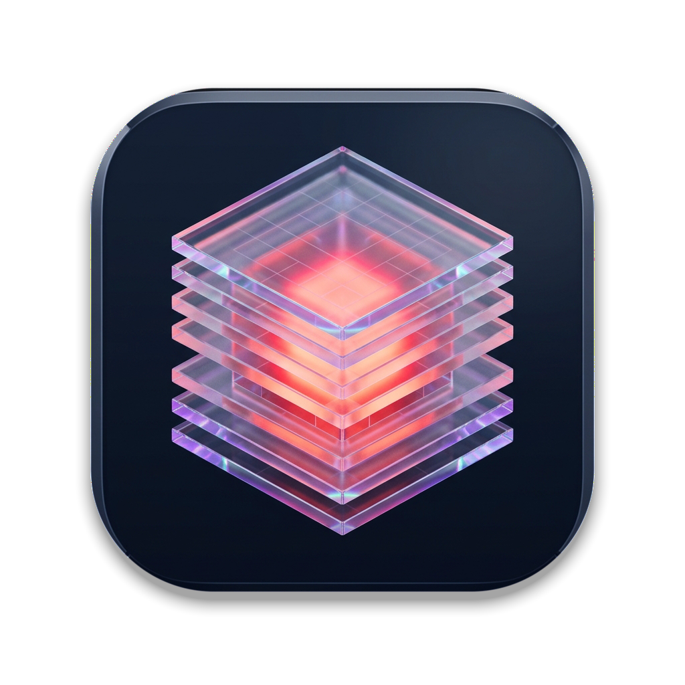

<div align="center">



# Memspace — Native Redis & Valkey GUI Desktop Client

A fast, lightweight, open-source native desktop GUI client for **Redis**, **Valkey**, **Dragonfly**, and **KeyDB** on **macOS, Windows, and Linux**. Built with **Go** and **Wails v3** for a ~35 MB RAM footprint and zero Electron bloat.

<p>
  <a href="https://github.com/pankaj-kumar34/memspace/releases/latest">
    
  </a>
  <a href="https://github.com/pankaj-kumar34/memspace/actions/workflows/release.yml">
    
  </a>
  
  
  
  
</p>

<p>
  <a href="#why-memspace-native-redis--valkey-gui-vs-electron-clients">Why Memspace?</a> ·
  <a href="#comparison-memspace-vs-other-redis-gui-clients">Comparison</a> ·
  <a href="#key-features">Features</a> ·
  <a href="#supported-databases--cloud-providers">Supported Databases</a> ·
  <a href="#installation">Installation</a> ·
  <a href="#building-from-source">Build from Source</a> ·
  <a href="#keyboard-shortcuts">Shortcuts</a> ·
  <a href="#architecture--tech-stack">Architecture</a> ·
  <a href="#frequently-asked-questions-faq">FAQ</a>
</p>

</div>

---

**Memspace** is a modern **Redis GUI**, **Valkey GUI**, and **in-memory database desktop manager** engineered for developers, SREs, and platform teams who want instant startup, low memory consumption, and production-safe database inspection without running a heavy Chromium/Electron wrapper.

Whether you manage a local Docker instance, an **AWS ElastiCache** cluster behind an **SSH bastion host**, **Upstash**, **Redis Cloud**, **GCP Memorystore**, or **Azure Cache for Redis**, Memspace gives you a responsive native desktop workspace with a non-blocking Key Explorer, full data-structure editors, an interactive Redis CLI console, a real-time Pub/Sub debugger, and live server diagnostics.

---

## Why Memspace? (Native Redis & Valkey GUI vs. Electron Clients)

Most Redis desktop clients ship an entire Chromium browser and Node.js runtime, consuming hundreds of megabytes of RAM just to browse keys. Memspace takes a native-first approach:

- **Featherweight Native Performance**: Powered by a Go backend and **Wails v3** native OS webviews (`WKWebView` on macOS, `WebView2` on Windows, `WebKitGTK` on Linux), Memspace stays around **~30–50 MB idle RAM** instead of the 300–600 MB+ typical of Electron-based Redis tools.
- **Production-Safe by Design**: Memspace **never** runs blocking `KEYS *`, unbounded `HGETALL`, or unbounded `SMEMBERS` during key browsing or previews. It strictly uses cursor-based `SCAN`, `HSCAN`, and `SSCAN`, pipelines `TYPE` and `TTL` lookups, truncates multi-megabyte string previews safely at 2 MB via `GETRANGE`, and uses cluster-slot-aware pipelined `UNLINK` for non-blocking key deletion.
- **OS Keychain Security**: Database passwords and SSH private-key passphrases are stored natively in **macOS Keychain**, **Windows Credential Manager**, and **Linux Secret Service** (`go-keyring`). Secrets are automatically redacted before saving connection metadata to `~/.memspace/connections.json`.
- **Read-Only Production Guardrails**: Organize servers into environment groups (`Production`, `Staging`, `Development`, `Local`) with color-coded badges and enable **Read-Only Mode** per connection to block destructive mutations (`FLUSHALL`, `FLUSHDB`, `DEL`, `UNLINK`, `SHUTDOWN`, `DEBUG`, `CONFIG`, `RENAME`, `RESTORE`, `MIGRATE`, `EVAL`, `EVALSHA`, `FCALL`) across both the GUI and CLI console.

---

## Comparison: Memspace vs. Other Redis GUI Clients

Looking for a lightweight, open-source alternative to **Redis Insight**, **Another Redis Desktop Manager (ARDM)**, **Medis**, **TablePlus**, or **RESP.app**?

| Feature / Metric | **Memspace** | **Redis Insight** | **Another Redis Desktop Manager** | **Medis 2** |
| :--- | :--- | :--- | :--- | :--- |
| **Runtime & Architecture** | **Go + Wails v3 (Native WebView)** | Electron (Chromium + Node.js) | Electron (Chromium + Node.js) | Swift (Native macOS) |
| **Typical Idle Memory** | **~30–50 MB** | ~300–600 MB+ | ~250–450 MB | ~100–200 MB |
| **License & Pricing** | **100% Free & Open Source** | Free / Source-available (SSPL) | Open Source (MIT) | Paid / Proprietary |
| **Platforms** | **macOS, Windows, Linux** | macOS, Windows, Linux | macOS, Windows, Linux | macOS only |
| **Topologies** | **Standalone, Sentinel, Cluster** | Standalone, Sentinel, Cluster | Standalone, Sentinel, Cluster | Standalone, Sentinel, Cluster |
| **Security** | **SSH Tunnel, TLS/mTLS, OS Keychain** | SSH Tunnel, TLS/mTLS | SSH Tunnel, TLS/SSL | SSH Tunnel, TLS/SSL |
| **Production Safety** | **Cursor `SCAN`, Read-Only Mode, Cluster `UNLINK`** | Cursor `SCAN`, Read-Only Mode | Cursor `SCAN` | Cursor `SCAN` |

---

## Key Features

### 1. Enterprise Connectivity & Security
- **All Redis & Valkey Topologies**: Connect to **Standalone** instances (with database selector `DB 0`–`DB 15`), **Redis Sentinel** high-availability clusters (master group resolution and failover support), and **Redis Cluster** (automatic slot routing across nodes).
- **Built-In SSH Bastion Tunneling**: Pure-Go SSH port forwarding via `golang.org/x/crypto/ssh` supporting password authentication and PEM/OpenSSH private keys (with optional passphrase) — no external `ssh` binary required.
- **TLS / mTLS Encryption**: Full SSL/TLS support with custom CA certificates, client certificates and private keys for mutual TLS (mTLS), automatic SNI server name extraction, and an optional skip-verify toggle for self-signed endpoints.
- **Native Credential Vault**: Passwords and SSH passphrases stay in your operating system's keychain and never touch disk in plaintext.
- **1-Click Localhost Quick Connect**: Instantly connect to `127.0.0.1:6379` from the welcome screen without cluttering saved connection profiles.

### 2. High-Performance Key Explorer
- **Non-Blocking Cursor Scanning**: Incremental `SCAN` with configurable batch counts and pipelined `TYPE` + `TTL` resolution so high-traffic production servers never stall.
- **Dual Exploration Modes**: Switch between a **Hierarchical Namespace Tree View** (auto-folded by `:`) and a **Virtualized Flat Table** powered by `@tanstack/react-virtual` for smooth scrolling across large keyspaces.
- **Instant Filtering & Metadata**: Filter keys by glob pattern (`user:session:*`) and data type (`string`, `hash`, `list`, `set`, `zset`, `stream`), while inspecting `TTL`, `MEMORY USAGE`, and `OBJECT ENCODING`.
- **Safe Key Management**: Edit or persist key TTLs (`EXPIRE` / `PERSIST`), rename keys (`RENAME`), hard-delete (`DEL`), or asynchronously reclaim memory with batch `UNLINK` (automatically slot-pipelined in Cluster mode to prevent `CROSSSLOT` errors).

### 3. Full Data Structure & Module Editors

| Data Type / Module | Capabilities in Memspace |
| :--- | :--- |
| **Strings & JSON** | Raw text editing, automatic JSON detection & syntax-highlighted formatting, inline TTL updates, and safe 2 MB `GETRANGE` preview truncation for oversized values. |
| **Hashes** | Bounded `HSCAN` previews, field/value inspector, add/edit fields (`HSET`), and remove fields (`HDEL`). |
| **Lists** | Range browsing (`LRANGE`), push to head/tail (`LPUSH` / `RPUSH`), pop (`LPOP` / `RPOP`), inline index editing (`LSET`), and item removal (`LREM`). |
| **Sets** | Bounded `SSCAN` previews, member search, add members (`SADD`), and remove members (`SREM`). |
| **Sorted Sets (ZSets)** | Score-ordered member table (`ZRANGE ... WITHSCORES`), add/update scores (`ZADD`), and member removal (`ZREM`). |
| **Redis Streams** | Timeline entry browser (`XRANGE`), add entries (`XADD`), delete entries (`XDEL`), Consumer Group & Consumer dashboards (`XINFO GROUPS`, `XINFO CONSUMERS`), and Pending Entries List (`XPENDING`) with `XACK`. |
| **RedisJSON** | Native `JSON.GET` and `JSON.SET` inspection with JSONPath (`$`) queries, interactive collapsible JSON tree view, and syntax-highlighted JSON editor. |

### 4. Interactive Redis CLI Console
- **Full Command Execution**: Run any Redis or Valkey command directly from the built-in console with smart quote and escape tokenization (`ParseCommandArgs`).
- **Autocomplete & Latency Metrics**: Inline Redis command syntax hints, command history navigation (`↑` / `↓`), formatted RESP responses, and exact per-command execution time in milliseconds.
- **Read-Only Enforcement**: Mutating and admin commands are blocked client-side when connected with Read-Only Mode enabled.

### 5. Real-Time Pub/Sub Debugger
- **Multi-Channel Subscriptions**: Subscribe to one or more Pub/Sub channels simultaneously (`SUBSCRIBE`) with live event streaming pushed directly from Go goroutines to the UI.
- **Live Feed & Message Publisher**: Inspect timestamped payloads as they arrive and publish test messages (`PUBLISH`) directly from the debugger pane.

### 6. Server Diagnostics, Slowlog & Client Manager
- **Structured `INFO` Dashboard**: Real-time parsed server telemetry organized across Server, Memory, CPU, Clients, Stats, Persistence, Replication, and Keyspace sections.
- **Slowlog Profiler (`SLOWLOG GET`)**: Inspect slow queries with microsecond execution durations, full command arguments, and client metadata.
- **Client Connection Manager (`CLIENT LIST`)**: Monitor active client connections (address, age, idle time, flags, DB, current command, buffers) with one-click `CLIENT KILL`.
- **Per-Key Memory Inspection**: Query exact memory footprint using `MEMORY USAGE`.

### 7. Built-In Auto-Updater
- **GitHub Releases Integration**: Checks `pankaj-kumar34/memspace` releases directly from the app, downloads platform-matched archives, verifies **SHA-256** checksums against `checksums.txt`, performs atomic binary replacement, and re-signs macOS `.app` bundles cleanly.

---

## Supported Databases & Cloud Providers

Memspace speaks standard RESP and works seamlessly with Redis and all major Redis-compatible engines and managed cloud services:

- **In-Memory Engines**: Redis (5, 6, 7, 8+), **Valkey** (7.2, 8+), **DragonflyDB**, **KeyDB**, **Apache Kvrocks**, **Garnet**, **Redict**
- **Cloud & Managed Services**: **AWS ElastiCache** (Redis & Valkey, Standalone & Cluster Mode Enabled), **Redis Cloud**, **Upstash Redis**, **Google Cloud Memorystore**, **Azure Cache for Redis**, **DigitalOcean Managed Valkey / Redis**, **Aiven for Caching**

---

## Installation

Download the latest pre-built native binary for your operating system from the **[GitHub Releases](https://github.com/pankaj-kumar34/memspace/releases/latest)** page.

### macOS (Apple Silicon `arm64` & Intel `amd64`)
1. Download `memspace-darwin-arm64.tar.gz` (M1/M2/M3/M4) or `memspace-darwin-amd64.tar.gz` (Intel).
2. Extract the archive and move `Memspace.app` into `/Applications`:
   ```bash
   tar -xzf memspace-darwin-arm64.tar.gz
   mv Memspace.app /Applications/
   ```
3. If macOS Gatekeeper warns about an unidentified developer on first launch, remove the quarantine attribute:
   ```bash
   xattr -cr /Applications/Memspace.app
   ```

### Windows (`x64`)
1. Download `memspace-windows-amd64.zip` from [GitHub Releases](https://github.com/pankaj-kumar34/memspace/releases/latest).
2. Extract `memspace.exe` to your preferred folder and run it (uses the built-in Microsoft Edge WebView2 runtime).

### Linux (`x64`)
1. Ensure GTK, WebKitGTK, and libsecret runtime libraries are installed (Ubuntu/Debian example):
   ```bash
   sudo apt-get update && sudo apt-get install -y libgtk-3-0 libwebkit2gtk-4.1-0 libsecret-1-0
   ```
2. Download and extract `memspace-linux-amd64.tar.gz`:
   ```bash
   tar -xzf memspace-linux-amd64.tar.gz
   chmod +x memspace
   ./memspace
   ```

---

## Building from Source

### Prerequisites
- **Go** `1.26+`
- **Node.js** `22+` (or `24+`) and `npm`
- **Wails v3 CLI** (`go install github.com/wailsapp/wails/v3/cmd/wails3@latest`)
- **Linux only**: `libgtk-3-dev`, `libwebkit2gtk-4.1-dev`, `libsecret-1-dev`, `pkg-config`

### Local Development & Production Build

```bash
# 1. Clone the repository
git clone https://github.com/pankaj-kumar34/memspace.git
cd memspace

# 2. Install and build the React + TypeScript frontend
cd frontend
npm ci
npm run build
cd ..

# 3. Run backend unit tests
go test ./backend/...

# 4. Run in hot-reload development mode (Wails v3)
wails3 dev

# 5. Or compile a production binary directly
go build -tags production -trimpath -ldflags="-w -s" -o bin/memspace .
```

---

## Keyboard Shortcuts

Press `Cmd + /` (macOS), `Ctrl + /` (Windows/Linux), or `?` anywhere outside text inputs to open the searchable **Keyboard Shortcuts** modal.

| Action | macOS | Windows / Linux |
| :--- | :--- | :--- |
| **Console (Terminal)** | `Cmd + 1` | `Ctrl + 1` |
| **Key Explorer** | `Cmd + 2` | `Ctrl + 2` |
| **Server Diagnostics** | `Cmd + 3` | `Ctrl + 3` |
| **Pub / Sub Debugger** | `Cmd + 4` | `Ctrl + 4` |
| **New Connection** | `Cmd + N` | `Ctrl + N` |
| **Toggle Sidebar** | `Cmd + B` | `Ctrl + B` |
| **Save Key Changes** | `Cmd + S` | `Ctrl + S` |
| **Clear Console Output** | `Cmd + K` | `Ctrl + K` |
| **Keyboard Shortcuts Help** | `Cmd + /` or `?` | `Ctrl + /` or `?` |

---

## Architecture & Tech Stack

| Layer | Technology | Role |
| :--- | :--- | :--- |
| **Desktop Shell** | [Wails v3](https://v3.wails.io/) (`github.com/wailsapp/wails/v3`) | Native OS WebView windowing, event bus, and Go-to-TypeScript RPC bindings |
| **Backend Runtime** | Go `1.26` | Non-blocking I/O, goroutines, connection pool management, and binary packaging |
| **Redis / Valkey Driver** | [`go-redis/v9`](https://github.com/redis/go-redis) | Standalone, Sentinel failover, Cluster slot routing, Streams, Pipelines, and Pub/Sub |
| **SSH Tunneling** | `golang.org/x/crypto/ssh` | Pure-Go SSH bastion port forwarding |
| **Secret Storage** | [`go-keyring`](https://github.com/zalando/go-keyring) | Native macOS Keychain, Windows Credential Manager, and Linux Secret Service |
| **Frontend UI** | React 19, TypeScript, Vite, Tailwind CSS v4 | Responsive desktop UI with Lucide icons and custom syntax highlighters |
| **List Virtualization** | `@tanstack/react-virtual` | High-performance scrolling across large keysets |

### Repository Layout

```text
memspace/
├── main.go                          # Wails v3 entrypoint, window setup, and service registration
├── Taskfile.yml                     # Cross-platform build & dev task definitions
├── build/                           # Platform icons, Info.plist, packaging configs, and assets
├── backend/
│   ├── connection/                  # ConnectionManager, Standalone/Sentinel/Cluster clients, TLS & SSH tunnel
│   ├── models/                      # Shared Go structs bound to TypeScript definitions
│   └── services/                    # Wails RPC services (Connection, Key, Data, Cli, PubSub, Diagnostics, Updater)
└── frontend/
    └── src/
        ├── App.tsx                  # Root workspace layout, connection switching, and keyboard shortcuts
        ├── bindings/                # Auto-generated Wails v3 Go-to-TypeScript bindings
        ├── components/              # Shared UI primitives, modals, and toasts
        └── features/                # connections, explorer, editors, terminal, pubsub, diagnostics
```

---

## Frequently Asked Questions (FAQ)

<details>
<summary><strong>Does Memspace work with Valkey, DragonflyDB, and KeyDB?</strong></summary>

Yes. Memspace uses the standard RESP protocol via `go-redis/v9` and works out of the box with **Valkey**, **Redis** (5 through 8+), **DragonflyDB**, **KeyDB**, **Redict**, and **Apache Kvrocks**.

</details>

<details>
<summary><strong>Is Memspace safe to connect to production Redis / Valkey instances?</strong></summary>

Yes. The Key Explorer never runs `KEYS *` — it uses cursor-based `SCAN` with pipelined `TYPE`/`TTL`, bounded `HSCAN`/`SSCAN` previews, and 2 MB `GETRANGE` string truncation. You can also enable **Read-Only Mode** on any connection profile to block destructive commands (`FLUSHALL`, `FLUSHDB`, `DEL`, `UNLINK`, `CONFIG`, `RENAME`, `EVAL`, etc.).

</details>

<details>
<summary><strong>How are database passwords and SSH passphrases stored?</strong></summary>

Passwords and SSH private-key passphrases are stored in your operating system's native secret vault (**macOS Keychain**, **Windows Credential Manager**, or **Linux Secret Service**) via `go-keyring`. They are stripped before saving non-sensitive connection metadata to `~/.memspace/connections.json`.

</details>

<details>
<summary><strong>Does Memspace support Redis Cluster, Sentinel, TLS/mTLS, and SSH tunnels?</strong></summary>

Yes. Every connection profile supports Standalone, Redis Sentinel, and Redis Cluster topologies, alongside built-in SSH bastion tunneling and TLS/mTLS client certificates — making it ready for AWS ElastiCache, Redis Cloud, Upstash, GCP Memorystore, and private VPC deployments.

</details>

---

## Contributing & License

Contributions, bug reports, and feature requests are welcome!

1. Fork the repository on GitHub.
2. Create a feature branch (`git checkout -b feat/my-feature`).
3. Run tests (`go test ./backend/...` and `cd frontend && npm run build`) before submitting a Pull Request.

If you find **Memspace** useful as your daily **Redis & Valkey GUI**, consider giving the repository a star on GitHub — it helps more developers discover a fast, native, Electron-free Redis client.
